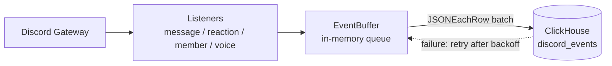

# Cordtrail

A [JDA](https://github.com/discord-jda/JDA)-based logging bot that subscribes to events (messages, reactions, members, voice) in every Discord guild it joins and records them in ClickHouse.

[](https://github.com/Uni0305/Cordtrail/actions/workflows/ci.yml)


## Features

- Records message, reaction, member, and voice events in a single `discord_events` table.
- Buffers events in memory and inserts them in `JSONEachRow` batches (every 1,000 events or 2 seconds by default).
- Retries with exponential backoff (1s to 60s) when ClickHouse is unavailable, and drops the oldest events once the buffer limit (100,000 by default) is exceeded.
- If the same batch fails 5 times in a row, the bot splits it and retries the parts. Only events that keep being rejected while the others succeed are dropped, with an `error` log. Events that cannot be serialized are dropped individually in the same way.
- Flushes remaining events for up to 10 seconds on shutdown.

## Getting started

### Prerequisites

> [!IMPORTANT]
> Enable the following two switches under **Privileged Gateway Intents** on the Bot tab of the Discord Developer Portal. Without them, the bot exits during login.
>
> - **Server Members Intent**: member join/leave/role/nickname events and the full member cache
> - **Message Content Intent**: recording message content

You will need:

- A Discord bot token
- Docker and Docker Compose, or JDK 25 and a reachable ClickHouse server

### Docker Compose (ClickHouse included)

```bash
cp .env.example .env   # fill in DISCORD_TOKEN and CLICKHOUSE_PASSWORD
docker compose up -d --build
docker compose logs -f bot
```

### Docker Compose with the prebuilt image

Release images are published to `ghcr.io/uni0305/cordtrail` for `linux/amd64` and `linux/arm64`. The server only needs [`docker-compose.prod.yml`](docker-compose.prod.yml) and `.env`, with no source checkout:

```bash
docker compose -f docker-compose.prod.yml pull
docker compose -f docker-compose.prod.yml up -d
```

It uses the `latest` tag by default. To pin a release, set `CORDTRAIL_TAG=1.2.3` in `.env`.

> [!WARNING]
> `.env` contains the bot token and the database password. Do not commit it to the repository.

### Run locally

```bash
./gradlew shadowJar
DISCORD_TOKEN=... CLICKHOUSE_URL=http://localhost:8123 \
  java -jar build/libs/Cordtrail-1.0-SNAPSHOT.jar
```

> [!NOTE]
> On startup the bot runs `CREATE DATABASE/TABLE IF NOT EXISTS`, so the ClickHouse account needs DDL privileges. The schema is in [`schema.sql`](src/main/resources/schema.sql). If ClickHouse is not ready yet, the bot retries up to 10 times at 3-second intervals.

## Configuration

Configuration is done through environment variables. With Docker Compose, `CLICKHOUSE_URL` is fixed to `http://clickhouse:8123`.

| Variable | Default | Description |
|---|---|---|
| `DISCORD_TOKEN` | (required) | Bot token |
| `CLICKHOUSE_URL` | `http://localhost:8123` | HTTP endpoint |
| `CLICKHOUSE_USER` | `default` | |
| `CLICKHOUSE_PASSWORD` | `""` | |
| `CLICKHOUSE_DATABASE` | `discord` | Letters, digits, and `_` only |
| `CLICKHOUSE_TIMEOUT_MS` | `30000` | ClickHouse connect/response timeout. Exceeding it counts as a failure and is retried |
| `BATCH_SIZE` | `1000` | Maximum number of events per INSERT |
| `FLUSH_INTERVAL_MS` | `2000` | Periodic flush interval |
| `BUFFER_CAPACITY` | `100000` | In-memory buffer limit. Must be at least `BATCH_SIZE` |
| `LOG_LEVEL` | `INFO` | |

All numeric values must be positive integers. With an invalid configuration, the bot logs an error and exits.

## Recorded events

| Category | `event_type` | Notes |
|---|---|---|
| Message | `message_create`, `message_update`, `message_delete` | Updates are recorded only for real edits (when `timeEdited` is present). A bulk delete produces one row per message with `payload.bulk = true` |
| Reaction | `reaction_add`, `reaction_remove`, `reaction_remove_all`, `reaction_remove_emoji` | |
| Member | `member_join`, `member_leave`, `member_role_add`, `member_role_remove`, `member_nickname_update`, `member_timeout_update` | |
| Voice | `voice_update` (join/leave/move), `voice_self_mute`, `voice_self_deafen`, `voice_guild_mute`, `voice_guild_deafen`, `voice_stream`, `voice_snapshot` | `voice_snapshot` captures who is in voice channels when the bot starts or reconnects |

The common columns are `event_id`, `event_time`, `received_at`, `guild_id`, `event_type`, `channel_id`, `user_id`, and `message_id`. All other details go into `payload` (JSON). Bot and webhook messages are recorded as well and can be told apart with `payload.author_is_bot` and `payload.is_webhook`.

## Example queries

```sql
-- Event count by type
SELECT event_type, count() FROM discord.discord_events GROUP BY event_type ORDER BY 2 DESC;

-- Recover the original content of deleted messages
SELECT d.event_time AS deleted_at, c.user_id, toString(c.payload.content) AS content
FROM discord.discord_events AS d
INNER JOIN discord.discord_events AS c ON c.message_id = d.message_id AND c.event_type = 'message_create'
WHERE d.event_type = 'message_delete';

-- Daily human messages per channel
SELECT toDate(event_time) AS day, channel_id, count()
FROM discord.discord_events
WHERE event_type = 'message_create' AND NOT payload.author_is_bot::Bool
GROUP BY day, channel_id ORDER BY day;

-- Deduplicate rows created by retries
SELECT * FROM discord.discord_events LIMIT 1 BY event_id;
```

## How it works



- Listeners convert each event into an `EventRecord` and only enqueue it, without blocking.
- The buffer flushes on a single thread once `BATCH_SIZE` events have accumulated or `FLUSH_INTERVAL_MS` has elapsed.
- A failed batch goes back to the front of the queue, and the wait before the next attempt doubles each time (up to 60 seconds).

## Development

```bash
./gradlew test
```

| Path | Role |
|---|---|
| `src/main/kotlin/.../listener` | Converts JDA events into `EventRecord`s |
| `src/main/kotlin/.../storage` | Buffer, JSONEachRow encoder, ClickHouse client and schema initialization |
| `src/main/kotlin/.../config` | Loads and validates environment variables |

### CI and releases

- [`ci.yml`](.github/workflows/ci.yml) runs tests, the Kover coverage report (uploaded as an artifact), `shadowJar`, and an amd64 Docker build on every pull request and every push to `master`.
- [`release.yml`](.github/workflows/release.yml) runs on `v*` tags. It reruns CI, then builds multi-arch images and pushes them to GHCR as `<version>` and `latest`. Prerelease tags such as `v1.3.0-rc.1` also update `latest`.

```bash
git tag v1.2.3
git push origin v1.2.3
```

Dependabot opens weekly update PRs for Gradle dependencies, GitHub Actions, and the Dockerfile base images.
