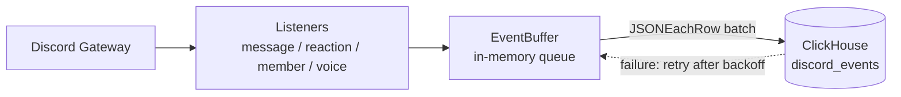

<div align="center">

# Cordtrail

**Record every Discord guild event (messages, reactions, members and voice) into ClickHouse.**

[](https://github.com/Uni0305/Cordtrail/actions/workflows/ci.yml)


[](https://github.com/Uni0305/Cordtrail/pkgs/container/cordtrail)
[](LICENSE.md)

[Features](#features) · [Getting started](#getting-started) · [Configuration](#configuration) · [Recorded events](#recorded-events) · [How it works](#how-it-works)

</div>

Cordtrail is a [JDA](https://github.com/discord-jda/JDA)-based bot that joins your Discord servers and records what happens in them. Every event goes into one append-only ClickHouse table, `discord_events`, so you can answer questions with plain SQL. For example, you can find who left last week, which channels are busiest, or what a deleted message said.

## Features

- **One table, flexible payload.** Common IDs are stored as columns, and event-specific details go into a ClickHouse `JSON` column.
- **Batched inserts.** Events are buffered in memory and written as `JSONEachRow` batches (every 1,000 events or 2 seconds by default).
- **Survives outages.** When ClickHouse is unreachable, the bot retries with exponential backoff (1s to 60s). The buffer is bounded (100,000 events by default) and drops the oldest events first.
- **Isolates bad records.** After 5 consecutive failures, a batch is split to find the events ClickHouse keeps rejecting. Only those events are dropped, and an `error` log is written for each.
- **Graceful shutdown.** Pending events are flushed for up to 10 seconds before the bot exits.
- **Ready to deploy.** Multi-arch (`amd64`/`arm64`) images are published to GHCR, with a Compose file that includes ClickHouse.

## Getting started

### Prerequisites

- A Discord application with a bot user ([Developer Portal](https://discord.com/developers/applications))
- Docker and Docker Compose, **or** JDK 25 and a reachable ClickHouse server

> [!IMPORTANT]
> Under **Bot → Privileged Gateway Intents**, enable both switches below. Without them, the bot exits during login.
>
> - **Server Members Intent**: member join/leave/role/nickname events and the full member cache
> - **Message Content Intent**: recording message content

Invite the bot with the `bot` scope (**OAuth2 → URL Generator**). It only records channels it can see, so grant **View Channels** wherever you want events captured.

### Option 1: Docker Compose (ClickHouse included)

```bash
cp .env.example .env   # fill in DISCORD_TOKEN and CLICKHOUSE_PASSWORD
docker compose up -d --build
docker compose logs -f bot
```

### Option 2: Prebuilt image

Release images are published to `ghcr.io/uni0305/cordtrail`. You do not need the source code on the server, only [`docker-compose.prod.yml`](docker-compose.prod.yml) and a `.env` file:

```bash
docker compose -f docker-compose.prod.yml pull
docker compose -f docker-compose.prod.yml up -d
```

The `latest` tag is used by default. To pin a release, set `CORDTRAIL_TAG` (e.g. `0.1.0`) in `.env`.

> [!WARNING]
> `.env` contains the bot token and the database password. Never commit it.

### Option 3: Run the jar

```bash
./gradlew shadowJar
DISCORD_TOKEN=... CLICKHOUSE_URL=http://localhost:8123 \
  java -jar build/libs/Cordtrail-0.1.0.jar
```

> [!NOTE]
> On startup the bot runs `CREATE DATABASE/TABLE IF NOT EXISTS` from [`schema.sql`](src/main/resources/schema.sql), so the ClickHouse user needs DDL privileges. If ClickHouse is not ready yet, the bot retries up to 10 times at 3-second intervals.

## Configuration

All configuration is done through environment variables (see [`.env.example`](.env.example)).

| Variable | Default | Description |
|---|---|---|
| `DISCORD_TOKEN` | (required) | Bot token |
| `CLICKHOUSE_URL` | `http://localhost:8123` | ClickHouse HTTP endpoint |
| `CLICKHOUSE_USER` | `default` | |
| `CLICKHOUSE_PASSWORD` | `""` | |
| `CLICKHOUSE_DATABASE` | `discord` | Letters, digits and `_` only, and must not start with a digit |
| `CLICKHOUSE_TIMEOUT_MS` | `30000` | Connect/response timeout. A timeout counts as a failure and is retried |
| `BATCH_SIZE` | `1000` | Maximum events per `INSERT` |
| `FLUSH_INTERVAL_MS` | `2000` | Periodic flush interval |
| `BUFFER_CAPACITY` | `100000` | In-memory buffer limit. Must be at least `BATCH_SIZE` |
| `LOG_LEVEL` | `INFO` | Logback log level |
| `CORDTRAIL_TAG` | `latest` | Image tag, used only by `docker-compose.prod.yml` |

Numeric values must be positive integers. If the configuration is invalid, the bot logs an error and exits.

> [!TIP]
> With either Compose file, `CLICKHOUSE_URL` is set to `http://clickhouse:8123` for you.

## Recorded events

| Category | `event_type` | Notes |
|---|---|---|
| Message | `message_create`, `message_update`, `message_delete` | Updates are recorded only for real edits (when `timeEdited` is present). A bulk delete produces one row per message with `payload.bulk = true` |
| Reaction | `reaction_add`, `reaction_remove`, `reaction_remove_all`, `reaction_remove_emoji` | |
| Member | `member_join`, `member_leave`, `member_role_add`, `member_role_remove`, `member_nickname_update`, `member_timeout_update` | |
| Voice | `voice_update` (join/leave/move), `voice_self_mute`, `voice_self_deafen`, `voice_guild_mute`, `voice_guild_deafen`, `voice_stream`, `voice_snapshot` | `voice_snapshot` captures who is in voice channels when the bot starts or reconnects |

Bot and webhook messages are recorded too. You can tell them apart with `payload.author_is_bot` and `payload.is_webhook`.

### Table layout

`{database}.discord_events` is a `MergeTree` table partitioned by month and ordered by `(guild_id, event_type, event_time)`.

| Column | Type | Description |
|---|---|---|
| `event_id` | `UUID` | Unique per event; use it to deduplicate |
| `event_time` | `DateTime64(3, 'UTC')` | When the event happened |
| `received_at` | `DateTime64(3, 'UTC')` | When the row was inserted |
| `guild_id` | `UInt64` | |
| `event_type` | `LowCardinality(String)` | See the table above |
| `channel_id`, `user_id`, `message_id` | `Nullable(UInt64)` | Set when relevant to the event |
| `payload` | `JSON` | Everything else, with snake_case keys |

## Example queries

```sql
-- Event count by type
SELECT event_type, count() FROM discord.discord_events GROUP BY event_type ORDER BY 2 DESC;

-- Recover the original content of deleted messages
SELECT d.event_time AS deleted_at, c.user_id, toString(c.payload.content) AS content
FROM discord.discord_events AS d
INNER JOIN discord.discord_events AS c ON c.message_id = d.message_id AND c.event_type = 'message_create'
WHERE d.event_type = 'message_delete';

-- Daily human messages per channel
SELECT toDate(event_time) AS day, channel_id, count()
FROM discord.discord_events
WHERE event_type = 'message_create' AND NOT payload.author_is_bot::Bool
GROUP BY day, channel_id ORDER BY day;

-- Deduplicate rows created by retries
SELECT * FROM discord.discord_events LIMIT 1 BY event_id;
```

> [!TIP]
> A retried batch can be partly written already, so the same event may appear twice. Use `LIMIT 1 BY event_id` when exact counts matter.

## How it works



1. **Listeners** convert each JDA event into an `EventRecord` and only add it to the queue. They never block the gateway thread.
2. **EventBuffer** flushes on a single thread when `BATCH_SIZE` events are queued or `FLUSH_INTERVAL_MS` has passed.
3. A **failed batch** goes back to the front of the queue. The wait before the next attempt doubles each time, up to 60 seconds.
4. After **5 consecutive failures**, the batch is split in half repeatedly. If some parts succeed, only the records that keep failing are dropped. If every part fails, the problem is treated as an outage and all records are kept.
5. On **shutdown**, the bot disconnects from Discord first and then flushes the buffer for up to 10 seconds.

## Development

```bash
./gradlew test                                  # all tests (JUnit 5 + MockK)
./gradlew test --tests '*EventBufferTest'       # a single test class
./gradlew koverHtmlReport                       # coverage report
./gradlew shadowJar                             # fat jar in build/libs/
```

| Path | Role |
|---|---|
| [`listener/`](src/main/kotlin/com/github/uni0305/cordtrail/listener) | Converts JDA events into `EventRecord`s (shared payload builders in `Payloads.kt`) |
| [`storage/`](src/main/kotlin/com/github/uni0305/cordtrail/storage) | Buffer, JSONEachRow encoder, ClickHouse client and schema initialization |
| [`config/`](src/main/kotlin/com/github/uni0305/cordtrail/config) | Loads and validates environment variables |

Tests do not need Discord or ClickHouse. JDA types are replaced with strict MockK stubs (`JdaStubs.kt`), and ClickHouse is replaced with an in-process HTTP server (`FakeClickHouseServer.kt`) that can return scripted status codes and delays.

> [!NOTE]
> Payload keys are part of the queryable data contract. Renaming one breaks existing queries, so add new keys instead.

### CI and releases

- [`ci.yml`](.github/workflows/ci.yml) runs on every pull request and every push to `master`. It runs the tests, the Kover coverage report (uploaded as an artifact), `shadowJar`, and an amd64 Docker build.
- [`release.yml`](.github/workflows/release.yml) runs on `v*` tags. It reruns CI, builds `amd64`/`arm64` images, and pushes them to GHCR as `<version>` and `latest`. Prerelease tags such as `v1.3.0-rc.1` also update `latest`.

```bash
git tag v0.1.0
git push origin v0.1.0
```

Dependabot opens weekly update PRs for Gradle dependencies, GitHub Actions, and the Dockerfile base images.
